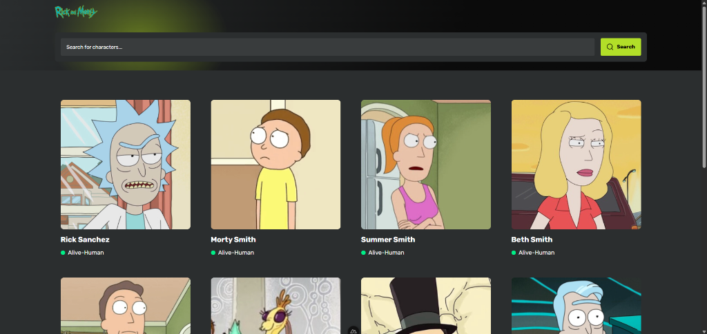
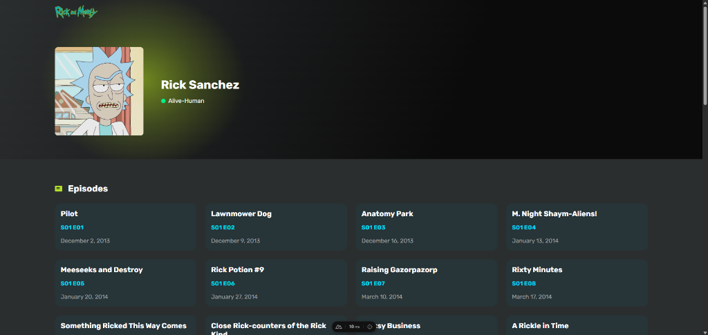

# Rick and Morty

Character search and detail pages built with Nuxt 4, TypeScript, Tailwind CSS, and Pinia.

## Preview

Live demo: [https://rick-morty-mehdispace.netlify.app](https://rick-morty-mehdispace.netlify.app)

| Character directory                                       | Character details                                             |
| --------------------------------------------------------- | ------------------------------------------------------------- |
|  |  |

## Requirements

- Node.js 22 or later

## Run locally

```sh
npm ci
cp .env.example .env
npm run dev
```

Rename `.env.example` to `.env`, then open http://localhost:3000.

Set `NUXT_PUBLIC_API_BASE=https://rickandmortyapi.com/api` in `.env`.

## Features

- Search by name and browse 12 characters per page.
- View episodes, origin, and current location on character pages.
- SEO-friendly character URLs with name slugs (e.g. `/characters/1-rick-sanchez`).
- Render pages on the server and cache API pages with Pinia for five minutes.
- Keep search and page numbers in the URL.

## Checks and production build

```sh
npm run check
npm run build
npm run preview
```
